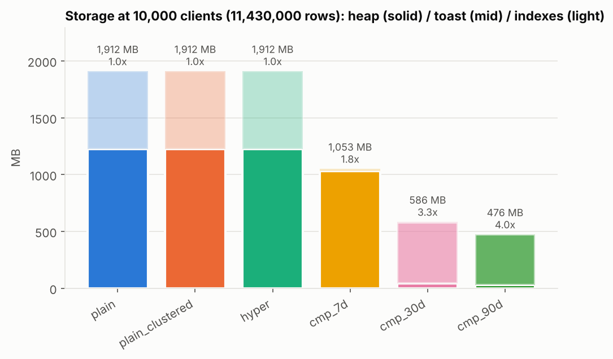
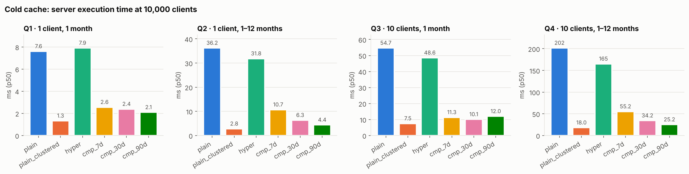
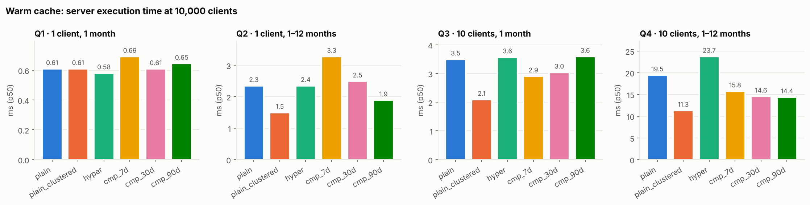
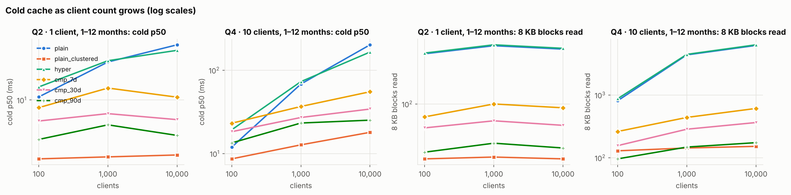

# Experiment log: TimescaleDB compression on bank transactions

Question: for per-client "statement" queries over checking + Visa transactions,
what does TimescaleDB (hypertables, then compression) buy in latency and storage
compared with plain Postgres, and how does that change as the number of clients
grows?

Visual version: [docs/report.html](docs/report.html), built by `python3 bench/build_html.py`. Charts: `results/figures/` (regenerate with `python3 bench/plots.py`). Full tables: [results/RESULTS.md](results/RESULTS.md). Raw data:
`results/latency_raw.csv`. Plans: `results/plans/`.

## Setup (all runs)

- **Host:** 4 vCPU, 16 GB RAM, cloud VM, Docker 29.8.
- **Image:** `timescale/timescaledb:2.30.2-pg18` (PostgreSQL 18.6, TimescaleDB 2.30.2). This was the newest tag on 2026-10-17.
- **Tuning:** `timescaledb-tune` pinned to 4 GB / 4 CPUs, which gives shared_buffers = 1.25 GB, effective_cache_size = 3.75 GB and work_mem = 16 MB. `jit=off` and `max_parallel_workers_per_gather=0` keep the latencies stable.
- **Data:** each client gets 3 purchases per day (60% Visa, 40% checking), payroll on the 1st and 15th, and a Visa payment from checking on the 25th. History is 1 year starting 2025-01-01, which works out to 1,143 rows per client per year. The data is deterministic (`setseed(0.42)`).
- **Load order:** rows are loaded in arrival (txn_ts) order. That is how a live system fills the table, so one client's rows end up scattered across the heap.
- **Indexes (identical on every variant):** `PRIMARY KEY (txn_id, txn_ts)` and `(client_id, txn_ts)`.
- **Compression settings:** `segmentby = client_id`, `orderby = txn_ts`.
- **Query parameters:**
  - Q1 and Q3 cover one random calendar month.
  - Q2 and Q4 cover a random range of 1 to 12 months, uniformly distributed.
  - Q3 and Q4 use 10 random clients.
  - Every variant gets the same parameter sequence.

### Variants

| variant | what |
|---|---|
| plain | heap table |
| plain_clustered | heap table `CLUSTER`ed on (client_id, txn_ts) after load. This is an upper bound for "rows of a client are adjacent" without TimescaleDB. It is not a steady state, because new rows arrive unclustered. |
| hyper | hypertable, 30-day chunks |
| cmp_7d / cmp_30d / cmp_90d | hypertable, all chunks compressed. 7 days is TimescaleDB's default chunk interval. |

### Measurements

- **warm:** 20 warm-up runs, then 200 measured runs per query, variant and scale. Each run is measured two ways:
  - **e2e:** a prepared statement executed from psycopg 3, with all rows fetched into Python.
  - **exec:** server execution time from `EXPLAIN (ANALYZE, TIMING OFF, BUFFERS)`. This excludes planning time and sending rows to the client.
- **cold:** before *every* execution, `pg_buffercache_evict_all()` empties shared_buffers and `echo 3 > /proc/sys/vm/drop_caches` empties the host page cache. Each query then gets 25 runs with different random parameters, measuring exec time and the 8 KB blocks read by the scans on transactions. The first run is discarded because it fills the backend's catalog caches. The harness refuses to run cold measurements if it can't drop the page cache. (Runs 1 to 3 dropped caches only once per variant; see run 4.)
- **storage:** `hypertable_detailed_size()`, or `pg_total_relation_size()` for plain tables. Both include heap, toast and indexes.

## How TimescaleDB compression works

TimescaleDB compresses one chunk at a time. Each chunk holds one time window, such as 30 days of rows.

1. **Group.** Rows are grouped by the `segmentby` column (`client_id`) and sorted by the `orderby` column (`txn_ts`). Each group is split into **batches** of up to 1,000 rows.
2. **Pivot to columns.** Each batch becomes *one* row in a hidden "compressed chunk" table. That row holds one compressed array per column (all the batch's `txn_ts` values, all its `amount` values, and so on), plus metadata: the `client_id`, the row count, and the batch's first and last `txn_ts`.
3. **Encode each column with a type-specific lossless codec:**
   - Integers and timestamps: delta-of-delta encoding, then Simple-8b bit packing and run-length encoding.
   - Floats: Gorilla XOR encoding.
   - Low-cardinality values (enums, repeated strings): a dictionary.
   - Everything else, such as free text and `numeric`: an array that Postgres's TOAST compression (pglz/LZ4) then compresses. Large arrays live in the chunk's TOAST table, which is why "toast" dominates the compressed sizes below.
4. **Index the metadata.** A btree on `(client_id, first_txn_ts, last_txn_ts)` lets a query find a client's batches for a date range without touching anything else.

Compression is **lossless**: every value comes back exactly as stored. Reads decompress on the fly. The plan shows a `ColumnarScan` over an index scan on the compressed chunk, and the time filter is then applied as a vectorized filter on the decompressed batch. Writes into already-compressed chunks, updates and deletes are possible but slower, so the usual pattern is to compress a chunk once its time window has closed.

## Why compression makes these queries faster

The cost of a per-client query is mostly **how many 8 KB pages it has to read**. On a cold cache, each page is a disk read.

- **Plain table and hypertable: rows are in arrival order.** Each day, all 10k clients' transactions arrive interleaved. One heap page holds about 73 rows (156,832 pages for 11.43M rows), and at 10k clients those 73 rows almost always belong to 73 different clients. One client's 95 rows for a month are therefore on about 95 different pages. Q4 returns about 6,500 rows and reads about 6,200 pages (48 MB). The index finds the rows quickly, but fetching each one is a separate page read. Splitting into time chunks doesn't change this, because each chunk is still in arrival order.
- **Compressed hypertable: rows are regrouped by client.** Because of `segmentby client_id`, one client's month (30-day chunk) or quarter (90-day chunk) is a single batch: a compressed row of about 5 KB, mostly in TOAST, spanning 1 or 2 pages. Q4 at 90-day chunks reads 174 blocks, 35x fewer than plain.
- **The bytes are also 3 to 4x smaller,** so the batches that are read carry less data. The win is mostly locality, though:
  - `plain_clustered`, the same plain table physically re-sorted by `(client_id, txn_ts)`, reads about as few pages as `cmp_90d` and is just as fast cold.
  - CLUSTER is a one-off: new rows land in arrival order again. Compression runs on every chunk once its window closes, so it keeps the client-grouped layout as data grows, and shrinks it at the same time.
- **Warm (everything in memory),** there is no disk to save. Visiting about 95 cached heap pages and decompressing one batch cost about the same CPU, so the variants tie on small queries. On Q4, compressed is about 25% faster because it touches fewer buffers.
- **Small tables don't benefit.** At 100 clients the whole table is 19 MB. Readahead pulls in neighbouring pages almost for free, and compressed is no faster than plain cold.
- **The gap grows with client count.** More clients means more other clients' rows interleaved between one client's rows, so plain's pages-per-row stays at about 1 while the table grows. Compressed reads stay nearly flat.

---

## Run 0: smoke test (100 clients, 20 iterations)

- I had mounted `./db/init` over `/docker-entrypoint-initdb.d`, which hid the image's own `000_install_timescaledb.sh` and `001_timescaledb_tune.sh`. I switched to mounting the files one by one.
- PG18 images keep PGDATA at `/var/lib/postgresql/18/docker`, so the volume now mounts at `/var/lib/postgresql`.
- `round(double precision, int)` doesn't exist, so I cast random() to numeric before rounding.
- Planner check: every variant uses the `(client_id, txn_ts)` index. On compressed chunks, the plan is `ColumnarScan` over an index scan on `(client_id, _ts_meta_v2_first_txn_ts, _ts_meta_v2_last_txn_ts)`, so the client and time filters are applied before anything is decompressed.
- Docker Hub returned HTTP 429 (rate limit) on the first pull. Pulling through `mirror.gcr.io` worked, and a plain pull worked a few seconds later.

## Run 1: 100 / 1k / 10k (aborted at 10k)

- At 10k clients the masked `account_number` (last 4 digits) collided with its UNIQUE constraint. The constraint was wrong, because masked numbers aren't unique, so I dropped it. I also made the harness write its CSVs after each scale, so a crash no longer loses the finished scales.
- Buffer counts in this run were misleading. The top-level `Shared Hit Blocks` included the nested-loop lookups into `accounts`, about 3 buffers per returned row, and those swamped the transactions access (6 buffers for Q1 on plain_clustered). From run 2 on, buffers are summed only over scans of `transactions` and its chunks.

## Run 2: 100 / 1k / 10k (complete)

- Storage and exec-time numbers matched run 3 within noise.
- **Finding: parameter types matter for prepared statements on compressed chunks.**
  - The e2e latency of Q4 on cmp_30d/cmp_90d at 100 clients was about 55 ms, against roughly 9 ms of server exec time.
  - Cause: psycopg sends small Python ints as `int2`, so the statement received an `int2[]` parameter. In the **generic plan**, `client_id = ANY(($1)::integer[])` was not pushed into the compressed chunk's segment index. It became a plain `Filter` above the `ColumnarScan`, so every client's batches in the time range were decompressed: 14,931 buffers and 41 ms, against about 10 ms with `int4[]`.
  - Plain and uncompressed hypertables were not affected, because a btree can still use the condition.
  - At larger scales Postgres kept using custom plans, so it hid the problem. Production code could hit it at any scale once a generic plan is cached.
  - **Fix:** bind client ids as `int4` (`psycopg.types.numeric.Int4`) or declare parameter types in `PREPARE`. The harness now does the former.

## Run 3: 100 / 1k / 10k (superseded for cold numbers)

The harness was fixed to bind ids as int4. Warm results and storage from this run match run 4. Its cold numbers were biased, as described next.

## Run 4: 100 / 1k / 10k (final, reported below)

Code review (Codex, on PR #1) found two real problems with the cold methodology:

- **Caches were reset once per variant, not per execution.** Each later run, and each query after Q1, could reuse pages loaded by earlier runs. At 100 clients, plain Q4 showed only about 4 blocks read, because Q1 to Q3 had already cached most of the 19 MB table. The bias favoured small tables, so it also favoured compressed variants at large scale, since they become fully cached sooner.
- **A failed `drop_caches` was only printed,** and the run was still labelled cold.

Fix: before every cold execution, evict shared_buffers with `pg_buffercache_evict_all()` (PG18) and drop the page cache. If the page cache can't be dropped, the run aborts. With the per-execution reset, plain/hyper cold latencies went up about 2x at 10k clients (Q4: 92 → 202 ms). Compressed went up less (Q4 cmp_30d: 29 → 34 ms), so the cold advantage of compression is larger than run 3 showed.

`python3 bench/run_ablation.py --clients 100,1000,10000`, then `python3 bench/report.py` and `python3 bench/plots.py`. The run took about 30 minutes, about 10 of them building the 10k-client variants (11.43M rows each).

### Storage

| variant | 100 clients | 1k clients | 10k clients | bytes/row @10k |
|---|---:|---:|---:|---:|
| plain | 19.2 MB | 191 MB | 1,912 MB | 175 |
| hyper | 20.2 MB | 192 MB | 1,912 MB | 175 |
| cmp_7d | 14.4 MB (1.3x) | 111 MB (1.7x) | 1,053 MB (1.8x) | 97 |
| cmp_30d | 7.4 MB (2.6x) | 60 MB (3.2x) | 586 MB (3.3x) | 54 |
| cmp_90d | 5.4 MB (3.6x) | 48 MB (4.0x) | 476 MB (4.0x) | 44 |

- Storage scales linearly with client count for every variant. The compression ratio stays roughly flat above 1k clients. At 100 clients, per-chunk fixed overhead lowers it.
- Of plain's 175 bytes per row, 107 are heap and 60 are the two btree indexes. Compressed chunks keep only a small segment index, about 0.2 to 2 bytes per row.
- **The chunk interval sets the ratio.** With `segmentby client_id`, a batch holds one client's rows for one chunk: 22 rows at 7 days, 94 at 30 days and 282 at 90 days, against a maximum of 1,000. Small batches pay per-batch header and toast overhead and give the codecs little to work with. The 7-day default is a poor fit for about 3 rows per client per day.
- Compressed bytes per row by column, measured on one chunk at 10k clients:

  | chunk | txn_id | txn_ts | account_id | vendor_id | txn_type | amount | description |
  |---|---:|---:|---:|---:|---:|---:|---:|
  | 7d | 3.9 | 10.2 | 2.4 | 3.2 | 3.1 | 8.9 | 43.6 |
  | 30d | 2.6 | 8.8 | 0.9 | 1.9 | 0.7 | 6.3 | 19.5 |
  | 90d | 2.3 | 8.6 | 0.6 | 1.7 | 0.4 | 5.2 | 15.4 |

  The free-text `description` (41 bytes raw, partly unique because of store numbers) and `txn_ts` dominate. `txn_ts` stays at about 8.6 bytes because purchase times are random within each day, so delta-of-delta encoding has little to remove.
- Compression time at 10k clients was 34 to 61 seconds for the whole year, on top of about 37 seconds to load and index.

### Latency at 10k clients (ms, p50)

| query | rows | plain warm | hyper warm | cmp_30d warm | cmp_90d warm | plain cold | hyper cold | cmp_30d cold | cmp_90d cold | plain_clustered cold |
|---|---:|---:|---:|---:|---:|---:|---:|---:|---:|---:|
| Q1 client, month | 95 | 0.61 | 0.58 | 0.61 | 0.65 | 7.6 | 7.9 | 2.4 | 2.1 | 1.3 |
| Q2 client, 1-12 mo | ~630 | 2.3 | 2.4 | 2.5 | 1.9 | 36.2 | 31.8 | 6.3 | 4.4 | 2.8 |
| Q3 10 clients, month | ~950 | 3.5 | 3.6 | 3.0 | 3.6 | 54.7 | 48.6 | 10.1 | 12.0 | 7.5 |
| Q4 10 clients, 1-12 mo | ~6,500 | 19.5 | 23.7 | 14.6 | 14.4 | 201.6 | 165.1 | 34.2 | 25.2 | 18.0 |

Warm = server exec time with the data in memory. Cold = server exec time with shared_buffers and the page cache emptied before every execution.

Blocks read from disk per query, cold, at 10k clients:

| query | plain | hyper | cmp_30d | cmp_90d | plain_clustered |
|---|---:|---:|---:|---:|---:|
| Q1 | 99 | 100 | 14 | 11 | 7 |
| Q2 | 624 | 641 | 49 | 23 | 16 |
| Q3 | 942 | 958 | 95 | 85 | 52 |
| Q4 | 6,165 | 6,312 | 364 | 174 | 152 |

### Findings

1. **A hypertable without compression gives these queries nothing.**
   - Latency and size match plain Postgres within noise. Planning takes about 0.3 to 0.7 ms longer, and a range is spread over several chunk indexes.
   - Chunk exclusion has nothing to exclude, because the `(client_id, txn_ts)` btree already narrows the range.
   - Hypertables would pay off for retention (dropping old chunks) or for queries over the whole fleet by time, and neither is in this workload.
2. **Compressed queries are faster once data comes from disk, and the gap grows with client count.**
   - At 10k clients cold, cmp_90d is 3.6x faster than plain on Q1, 8x on Q2, 4.6x on Q3 and 8x on Q4.
   - The reason is blocks read: plain Q4 reads about 6,200 blocks (about 48 MB) for about 6,500 rows. Arrival-order loading puts each of a client's rows on a different heap page, so every row costs a page read. cmp_90d reads 174 blocks.
   - Plain's cold latency grows with the table, because more clients means more pages interleaved between one client's rows. Compressed stays nearly flat (see the scaling chart).
   - At 100 clients the whole table is 19 MB, plain and compressed are close cold, and cmp_7d/cmp_30d are slower than plain on Q4.
3. **Warm, the variants are close.**
   - When the working set is in memory, every variant answers Q1 to Q3 in under about 4 ms. On the tiny Q1, compressed is level with plain because decompression costs a little CPU.
   - On the bigger Q4, compressed is about 25% faster (14.5 vs 19.5 ms), because it touches fewer buffers.
4. **Most of the cold win comes from locality, not from fewer bytes.**
   - `plain_clustered` reads about as few blocks as cmp_90d and is the fastest variant cold. `segmentby client_id` is effectively a CLUSTER that stays in place, because each chunk is compressed once, after its time window closes.
   - Compression adds 4x less disk on top of that locality, and keeps it as new data arrives. A clustered plain table loses its ordering as new rows arrive.
5. **Chunk interval matters more than anything else that was tunable.**
   - The 7-day default doubles storage compared with 30 days and is the slowest compressed variant on most queries. It has 53 chunks a year, so Q2/Q4 planning takes 4 to 5 ms, and its tiny batches add decompression and toast overhead.
   - 90 days was best on both size and latency here. A month query decompresses up to 3x more rows than it returns, but that costs less than the extra batches and chunks.
6. **End-to-end costs.**
   - Client-side e2e is about 2 to 4x the server exec time. Fetching about 6,500 rows into Python costs around 15 to 20 ms.
   - Compressed variants plan 0.2 to 1.2 ms longer, or 4 to 5 ms at 7-day chunks. Postgres keeps using custom plans, so that cost is paid on every call. At 10k clients warm, compressed e2e is still equal to or faster than plain.
7. **Bind parameter types correctly** (see run 2). An `int2[]` parameter in a cached generic plan makes compressed chunks decompress every segment in the time range.

### Caveats

- 10k clients (11.4M rows, 1.9 GB uncompressed) is the largest scale that fit the session's disk next to six variants. Even plain fits in RAM at that size. The cold runs simulate a larger-than-memory dataset by emptying shared_buffers and the page cache before each execution, which is a worst case: in production, index upper levels and hot clients would stay cached.
- Single client connection, no concurrent writes. A real system would also be inserting into the newest, still uncompressed chunk, and would compress chunks with a policy.
- The PK `(txn_id, txn_ts)` on the compressed variants triggers TimescaleDB's warning "column txn_id should be used for segmenting or ordering". It only matters for uniqueness checks when inserting into compressed chunks, which this workload does not do.
- `plain_clustered` is a best case that would not hold in production. `CLUSTER` sorts the table once. Postgres does not maintain that order, so new rows are appended in arrival order and locality decays back toward `plain` as the table grows. Re-clustering rewrites the whole table and holds an ACCESS EXCLUSIVE lock, which blocks reads and writes for the whole rewrite. At 10k clients, building the indexes plus `CLUSTER` took 67 s against 18 s for plain's indexes (`index_s` in `results/build.csv`). This benchmark measured it only immediately after the sort, so its cold numbers are an upper bound for any plain-table layout. The compressed variants were also measured right after a full compression, but TimescaleDB re-applies the grouping chunk by chunk as each time window closes.
- 30-day chunks are aligned to the epoch, not to calendar months, so a month query usually touches 2 chunks.

### Next ideas

- Larger scales, such as 100k clients, on a bigger disk, and multi-year history to see chunk exclusion matter.
- A 1-year chunk interval, where batches approach the 1,000-row maximum.
- Making descriptions more compressible: drop the store number, or split it into its own integer column.
- Concurrent ingest with a compression policy, and query latency on the uncompressed "hot" chunk.
- A covering index `(client_id, txn_ts) INCLUDE (...)` on plain, for index-only scans.
